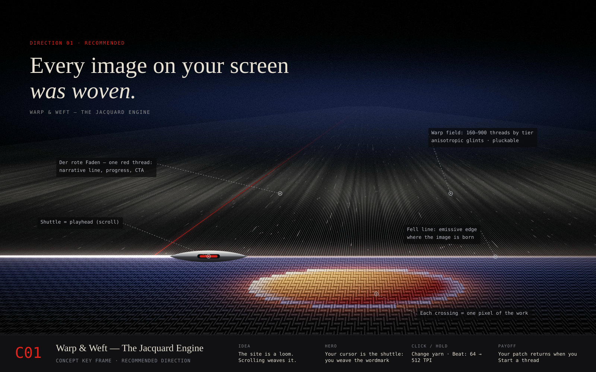
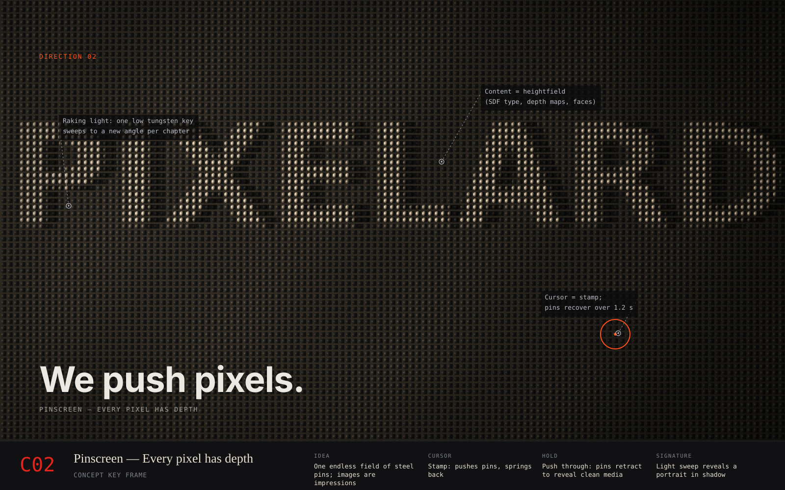
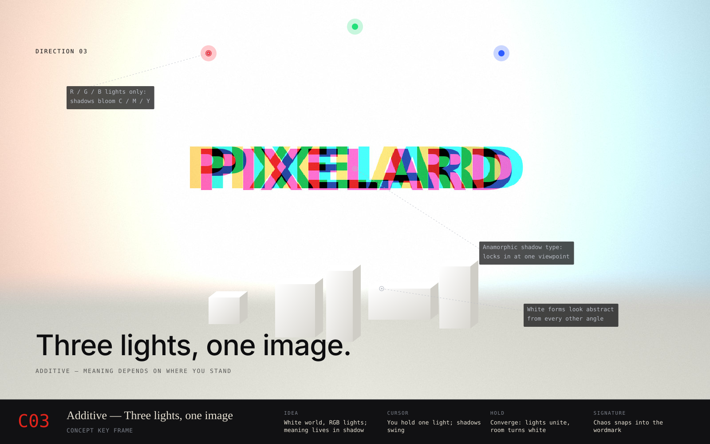

# 02 — Three Original Creative Directions

> **Brief, restated.** Build an original studio site for **Pixelard Studio** that competes with the best immersive work on the web. Every direction below follows the rules in `01-reference-analysis.md` §D3. **The hero rules (H1–H6) come first**, because the homepage hero is what wins or loses the visitor:
>
> | Rule | |
> |---|---|
> | H1 | The 3-second test |
> | H2 | The hero toy *is* the idea |
> | H3 | Type beside the world |
> | H4 | The preloader hands off through the brand |
> | H5 | A repeatable reward |
> | H6 | Play leaves a trace |
>
> Then the system rules (P1–P10). Each direction rejects the reference's visual identity.

> **Assumption.** The studio name, read from the repository, is *Pixelard*. All three directions start from a creative reading of that name. Where a direction rests on history, the facts are cited at the bottom of this document.

Each direction defines:
- the core idea
- **the hero: the first 10 seconds**
- a visual concept and palette
- typography
- 3D art direction
- an interaction philosophy (cursor, press-and-hold, scroll and sound)
- how the experience changes as you scroll
- a signature moment
- risks and feasibility

Key frames for all three are in `storyboards/` (`c01`–`c03`).

---

## Direction 01 — WARP & WEFT
### *"The Jacquard Engine"* · **Recommended**

**The truth it starts from.** Say *Pixelard* aloud next to *Jacquard*. In 1804, Joseph-Marie Jacquard's loom became the first machine to follow instructions on punched cards. In 1843, Ada Lovelace wrote that Babbage's Analytical Engine *"weaves algebraical patterns just as the Jacquard loom weaves flowers and leaves."* A woven image is a grid of thread crossings, each one a single colour. That makes it the ancestor of the pixel. Pixelard is the studio that still weaves: **craft and computation in one gesture.** No other studio can claim this story.

**The idea.** The website is a working loom. You don't scroll down a page. **You weave it.** Scroll drives the shuttle, each chapter is woven into existence as luminous cloth, and **one red thread** runs through the whole site. It guides the story and becomes the final call to action. (In German and Swedish, *der rote Faden* / *den röda tråden* is the common thread of a story. Goethe took the image from the red thread twisted through Royal Navy rope.)

### Visual concept
- A near-black studio. Hundreds of hairline **warp threads** under tension recede into soft fog. They look like glass fibre or fibre optic, catching sharp anisotropic glints.
- At the **fell line** (where new weft is beaten in), the cloth glows with imagery, like a luminous textile.
- The camera uses **macro photography** language: shallow depth of field, rack focus, specular sparkle and fibre fuzz.
- **Up close it is structure; from afar it is a picture.** That optical shift is the emotional engine of the site.
- **Not handicraft.** No wool, no rustic wood, no cottage warmth. The reference points are technical textile engineering, carbon-fibre weave, Issey Miyake pleating and the precision of a Swiss movement.

### Palette
| Token | Hex | Use |
|---|---|---|
| Loom Black | `#0A0A0B` | World and page background |
| Graphite Thread | `#2A2B2E` | Idle warp, rules, borders |
| Raw Silk | `#E8E2D4` | Primary text on dark; light-mode surfaces |
| Indigo Depth | `#22306E` | Fog tint, secondary atmosphere |
| **Roter Faden** | `#E3241B` | **One thread only.** The red thread, focus states, primary CTA. Never decorative. |

Colour in imagery comes only from the **work**, woven into the cloth.

### Typography
- **Display:** *GT Alpina* (Grilli Type), Light/Regular, plus italic for quotations. It is a contemporary serif with mechanical and typewriter siblings, so display and UI come from one family. **Open-source fallback:** *Instrument Serif*.
- **Labels, indices, thread counts:** *GT Alpina Typewriter*. **Open-source fallback:** *Geist Mono*. Uppercase, 11–12px, +6% tracking.
- **Custom glyph set, "Pixelard Card":** a 5×7 punch-hole matrix for numerals, chapter indices, the menu and the preloader counter. It is SVG in the DOM and SDF holes in WebGL. The glyph set is small (0–9, A–Z), so it can be produced in-house.
- **Behaviour:** headlines are revealed **row by row from top to bottom, like weft being beaten in**, as stepped horizontal bands (no fades). Chapter words are set huge (8–14vw), one word each: *Warp. Weft. Pattern. Draft. Selvedge.*

### 3D art direction
- **Warp field.** 160–900 threads depending on device tier. They are camera-facing ribbons with Kajiya-Kay anisotropic highlights, a subtle per-thread hue drift and exponential fog.
- **Cloth.** A procedural **weave shader** on a single plane. It renders plain, twill and satin structures. Each thread crossing samples one colour from a source image or video. A glowing emissive line marks the fell.
- **Shuttle.** One hero object: polished steel and ceramic, minimal, boat-shaped. It is the site's **playhead**.
- **Punch cards.** Thin, pale card instances. Their holes encode real data: each chapter's title in binary, as a hidden easter egg.
- **Light.** One soft overhead key and a strong backlight so threads glint, with almost no fill. Chiaroscuro.
- **Lens.** FOV 18–28°, slow dolly moves, rack focus between thread and text.

### The hero: the first 10 seconds
*(Full storyboard: `03-experience-storyboards.md` §5, frames H01–H05.)*

- **Preloader → portal (H4).**
  - A single red thread tensions across black as assets load.
  - At 100% it rises and **becomes the loom's back beam**.
  - Some 150 warp threads unroll from it, centre-out, and one drops in red.
  - *One thread becomes the warp.*
- **Stage (H3).**
  - The headline sits above the back beam in clear space.
  - The warp spans the stage between two hairline beams, a frame that is native to the loom.
  - The beams **part as you scroll**, opening the frontal loom into a horizon-deep world.
- **The toy is the thesis (H2). Your cursor is the shuttle.**
  - Moving across the warp lays a weft thread that goes over and under alternate threads.
  - Each full pass beats a row into the cloth.
  - Row by row, the visitor **weaves the Pixelard wordmark as a Jacquard**.
  - Within seconds they have *made* a woven image, and have understood the studio's whole idea with their hands.
  - Vertical movement still plucks the threads.
- **Repeatable reward (H5). Click to change yarn.**
  - Each click snips and cycles the weft colour: silk → madder red → indigo → ochre.
  - Every visitor weaves a slightly different hero.
- **Trace and payoff (H6).**
  - The visitor's woven patch persists for the session.
  - If they scroll before finishing, the loom completes the rows.
  - In the finale (*Start a thread*), **the cloth the red thread pulls free from is the patch they wove.**
- **3-second test (H1).**
  - **Craft:** glossy, anisotropic threads and real crossings.
  - **Action:** the first mouse movement weaves or plucks.
  - **Statement:** *"Every image on your screen was woven."*

### Interaction philosophy: *"Everything is under tension."*
The visitor is a weaver, not a viewer.

| Input | Response | Metaphor |
|---|---|---|
| **Move horizontally** across the warp (hero) | **Your cursor is the shuttle.** A weft trails it over and under the threads; each full pass beats a row into the cloth | You weave the first image |
| **Click** (hero) | **Change yarn.** Cycles the weft colour; the next rows weave in it | Every visitor weaves a different hero |
| **Move** across threads (elsewhere) | Threads **pluck**: a damped vibration, a glint and a soft tuned note | Strings under tension |
| **Cursor over media** | Becomes a **pick glass**, the folding magnifier weavers use to count threads. A square loupe shows the magnified weave with a ruler. | Inspecting the craft |
| **Cursor over links** | The cursor's red tail **wraps the link and ties a knot** (underline) | Fastening |
| **Press and hold** | **"Beat."** The weave compacts, **thread count climbs 64 → 512**, the image resolves sharper and a low tone rises | Tighter weave means higher resolution |
| **Scroll** | Drives the shuttle. Forward weaves, backward unweaves. | Time is cloth |
| **Sound** (opt-in) | Karplus-Strong string plucks quantised to one scale, a soft loom clack on chapter beats, shuttle air | A playable instrument |

### How it changes as you scroll (Home)
| Chapter | World state | Content beat |
|---|---|---|
| 00 Tension | A single red thread is drawn across black as assets load | Preloader |
| 01 The Loom (hero) | A frontal loom between two beams. **The visitor weaves the wordmark with the cursor.** On scroll the beams part and the warp tilts into a horizon-deep field. | *"Every image on your screen was woven."* |
| 02 1804 | The shuttle's first pass; punch cards drift by; first glowing rows | Origin: Jacquard, then Lovelace, then the pixel, then Pixelard |
| 03 Weave | The showreel woven into cloth; the camera pulls back from macro to wide | Manifesto; **hold to beat** |
| 04 Pattern Book | The cloth travels sideways; each project is woven as a panel with a selvedge label | Selected work (4–6) |
| 05 Draft | The world calms to a weaving draft: grid notation, live swatch | Capabilities |
| 06 Selvedge | Clients as woven labels; team as Jacquard-woven portraits | Proof and people |
| 07 Start a thread | The red thread pulls free from the cloth and becomes the CTA | Contact; then leads on to Work |

**Signature moments.**
1. **The hero:** the visitor weaves the wordmark with their own cursor, then watches it lie down in the foreground as the loom opens to the horizon.
2. **The macro-to-wide pull-back.** Glinting threads you could almost touch resolve, as the camera retreats, into a moving woven showreel. *"Up close, it's structure. From afar, it's a story."*

**Why it wins.**
- **Its hero toy is the thesis.** Lusion's hero proves rendering skill. Ours proves rendering skill *and* explains the studio, and what the visitor makes is remembered and paid off at the end.
- It is an ownable origin myth: the name, the history of computing and the craft are one story.
- The weave shader, string physics and pick-glass loupe are new on the web.
- The interaction is musical and tactile.
- One metaphor governs everything: loader, menu (punch card), transitions (shuttle pass), 404 (a dropped stitch).

**Risks and mitigations.**
1. **Reads as "crafty."** Keep the art direction luminous, technical and dark.
2. **Moiré and aliasing from fine threads.** Use analytic anti-aliasing and blend to the source image by derivative LOD. This is the week-one R&D spike.
3. **The effect must never degrade the work.** Case studies *unweave* to clean media.
4. **The history can become a lecture.** It gets one chapter, three sentences.

**Feasibility:** medium-high. **Performance outlook:** excellent. The cloth is one quad, and source images only need thread-count resolution (e.g. 320×180).

---

## Direction 02 — PINSCREEN
### *"Every pixel has depth"*

**The truth it starts from.** "Pixel-pusher" is the industry's put-down for designers who obsess over detail. Pixelard takes it literally. In 1933, Alexandre Alexeieff and Claire Parker animated films on a **pinscreen**: a board of hundreds of thousands of pins, pushed to different depths and lit from the side, so the *shadows* made the picture. It was an analog pixel display with a third dimension.

**The idea.** The whole site is one endless pinscreen: a field of polished steel pins. Every word, image and face is an **impression** pushed into the pins and revealed by a **raking light**. You push pixels with your hand.

### Visual concept
- A graphite void and a vast plane of steel pins in a tight grid. One low, warm light skims the surface, and long shadows **draw** the image.
- It is monochrome by nature: imagery is light and shadow, and colour appears only as the light's temperature and in clean media panels.
- Sculptural, museum-quiet and expensive, somewhere between a Richard Serra gallery and a Braun product shot.

### Palette
| Token | Hex | Use |
|---|---|---|
| Graphite | `#111214` | Void, background |
| Steel | `#9EA4AA` | Pin body, rules |
| Bone | `#ECE9E2` | Text, light surfaces |
| Tungsten | `#FFC58A` | The raking light (atmosphere only) |
| **Cadmium** | `#FF4F1A` | Cursor and CTA only |

### Typography
- **Display:** *PP Right Grotesk* (variable widths, compact to spatial). **The width axis is tied to pressure**: words widen as pins are pushed. **Open-source fallback:** *Archivo* (variable `wdth` 62–125).
- **UI and data:** *Berkeley Mono*. **Open-source fallback:** *JetBrains Mono*.
- **Relief type:** headlines are also embossed into the pin field, using SDF heightmaps of the same font. The DOM text mirrors them for accessibility.

### 3D art direction
- **Pins.** Instanced pins: 96×54 on mobile, 160×90 on mid-tier, 256×144 on high-tier.
- **Height.** Each pin's height comes from a composited heightfield render target with four inputs: content depth maps, SDF text, a cursor-impression buffer, and slow noise.
- **Material.** Brushed-steel anisotropic material with one PMREM environment.
- **Shadows.** Raymarched across the heightfield for the long raking shadows.
- **Camera.** Long lens, FOV 15–20°, so the field reads as a surface. Occasional low tilts reveal that it is deep.

### The hero: the first 10 seconds
- **Preloader → portal.** The load counter is pressed into a small patch of pins as relief digits. At 100% the digits **flush flat in a ripple** that spreads to fill the stage, and the raking light sweeps in.
- **Stage.** The headline sits above the field. The field is cropped by the page margins with no card or radius: an edge-to-edge steel plane.
- **Toy = thesis. You push pixels.** The cursor stamps the pins; dragging **draws** a groove that slowly recovers. Visitors write and doodle in steel.
- **Repeatable reward. Click to move the sun.** The raking light jumps to a new angle and temperature (tungsten → daylight → sodium), and every impression re-reads differently.
- **Trace.** The visitor's last drawing is kept. In *Leave your mark* (contact) it becomes their signature.
- **3-second test.** Craft: steel and shadow. Action: the stamp. Statement: *"We push pixels."*

### Interaction philosophy: *"Leave an impression."*
Everything you touch remembers you, briefly.

| Input | Response |
|---|---|
| **Move** | The cursor is a **stamp**. Pins sink within a radius set by velocity and spring back over about 1.2 s, a short memory trail. |
| **Press and hold** | **"Push through."** Pins sink deeper and wider. On a media panel, they retract fully to reveal the clean video beneath. |
| **Scroll** | **The light travels.** Each chapter sweeps the raking light to a new angle and a new impression. Between chapters, a levelling wave flushes the field flat. |
| **Sound** | Granular metallic ticks (density follows how many pins are moving), plus a deep resonant tone on each light sweep. |

### How it changes as you scroll
**Flat** (featureless steel, a light sweep hints at the wordmark), then **Impression** (*"We push pixels."* rises in relief), then **Depth** (manifesto as three impressions), then **Work** (projects as relief depth maps, push through to play), then **Faces** (team portraits in relief, the light orbits), then **Process**, then **Leave your mark** (contact: the visitor's cursor drawing stays as a signature on their message).

**Signature moment.** A perfectly flat steel field. A single light sweeps across it, and a portrait that "was always there" appears in its shadows.

**Risks.**
- Monochrome monotony: vary the light colour and angle per chapter.
- The pin-art toy is familiar: the light-sweep storytelling must carry it.
- Shadow cost: use hybrid normal-mapped pins away from the camera.

**Feasibility:** high. **Performance outlook:** good; shadows are the heaviest cost.

---

## Direction 03 — ADDITIVE
### *"Three lights, one image"*

**The truth it starts from.** Every colour on every screen is three lights (red, green and blue) added together. A pixel is not a dot of paint; it is **three lights agreeing**. Pixelard's three disciplines work the same way:

| Light | Discipline |
|---|---|
| Red | Design |
| Green | Motion and 3D |
| Blue | Technology |

Apart, each is a colour. Together, they make white light: a complete experience.

**The idea.** A white sculptural world lit only by three moving coloured lights. Where all three reach, surfaces read white. Where an object blocks one light, its shadow takes the colour of the other two: **cyan, magenta, yellow**. Meaning lives in the shadows: random-looking white forms cast coloured shadows that resolve into words and images **from one exact viewpoint** (anamorphic shadow typography). Scroll moves the camera and the lights until meaning **snaps into alignment.**

### Visual concept
- A chalk-white gallery space with a softly curved floor-to-wall cove. The forms are matte plaster and ceramic.
- Crisp coloured shadows overlap into secondary colours.
- The feel is optical and lab-precise, with an unashamed joy in colour. The lineage runs from James Turrell's light rooms to coloured-shadow installations and anamorphic shadow sculpture.

### Palette
| Token | Hex | Use |
|---|---|---|
| Chalk | `#F3F2EE` | World and page background |
| Ink | `#0D0D0F` | Text |
| Light R / G / B | `#FF2D3A` / `#22E07A` / `#2D5BFF` | Lights only |
| Shadow C / M / Y | `#22D7F0` / `#FF2DD6` / `#FFE13A` | Appear only as shadows. **Never** flat UI fills. |

### Typography
- **Display and UI:** *Suisse Int'l* and *Suisse Int'l Mono* (Swiss Typefaces). Their neutral, instrument-label precision lets the light carry the expression. **Open-source fallback:** *Inter Display* with *Geist Mono*.
- **Behaviour, "registration reveal":** headlines enter as three offset copies (R, G and B, blended additively) that converge into one crisp ink word, like press registration locking in.
- **Shadow type:** key words exist as authored 3D anamorphic arrangements, mirrored by DOM text.

### 3D art direction
- **Forms.** Matte white sculpted primitives plus a few organic forms, with baked AO on the floor and cove.
- **Lights.** Three spotlights with soft PCF shadows: 1024² each on high tier; on mobile, baked shadows plus the one cursor-driven dynamic light.
- **Camera.** Authored viewpoints with an **alignment snap**, a short spring into the exact anamorphic position.

### The hero: the first 10 seconds
- **Preloader → portal.** One white point of light grows with load progress. At 100% it **splits into three** (red, green, blue), and the room appears in the light they make.
- **Stage.** The headline sits above. The room is the stage, and the cove of the floor and wall is its frame.
- **Toy = thesis. You hold a light.** Moving swings the green light, and coloured shadows sweep across the room. A few white forms reveal that their shadows *almost* spell something.
- **Repeatable reward. Click to swap lights.** You now hold red, then blue, and the shadow colours rotate. Bringing all three into alignment locks the wordmark in shadow.
- **Trace.** The light positions the visitor leaves become the site's lighting for the session.
- **3-second test.** Craft: physically correct coloured shadows. Action: the light moves. Statement: *"Every colour on your screen is three lights agreeing."*

### Interaction philosophy: *"Meaning depends on where you stand."*
| Input | Response |
|---|---|
| **Move** | You hold one light (green by default). Shadows swing across the room, and you paint with coloured shadow. |
| **Press and hold** | **"Converge."** The three lights pull into one point. Colour collapses into a single black shadow and the room turns pure white, a moment of total clarity. Release, and the colour blooms back. |
| **Scroll** | The camera travels between viewpoints. In between, forms look abstract. At each viewpoint, words and images lock in with a soft click. |
| **Sound** | Three detuned pad voices, one per light. Converging resolves them to a unison chord; alignment chimes. |

### How it changes as you scroll
**White** (one light, one form, a black shadow: *"Every colour you've seen on a screen…"*), then **Split** (the light divides into R, G and B, shadows bloom C, M and Y: *"…is three lights, agreeing."*), then **Alignment** (a pile of forms, the camera orbits, the shadows spell PIXELARD), then **Disciplines** (one light per discipline), then **Work** (projects cast as coloured silhouettes that cross-fade into clean media on the wall), then **People**, then **Converge** (contact: *"Let's make something whole."*).

**Signature moment.** Chaos of white objects, one more scroll tick, and the coloured shadows lock into the wordmark.

**Risks.**
- Anamorphic authoring is labour-intensive. Budget Blender geometry-nodes tooling.
- Three shadow maps are expensive. Bake the static ones.
- White scenes band easily. Use blue-noise dither and AgX tone mapping.
- Coloured shadows are a known science demo. Their meaning has to come from typography.

**Feasibility:** medium. **Performance outlook:** medium.

---

## Comparison

Each criterion is scored 1–5 (5 = best for Pixelard).

| Criterion | 01 Warp & Weft | 02 Pinscreen | 03 Additive |
|---|:-:|:-:|:-:|
| **Hero: 3-second test and toy = thesis (H1–H6)** | **5** | **5** | 4 |
| Originality on the web | **5** | 3 | 3 |
| Brand ownership (only Pixelard could do it) | **5** | 3 | 3 |
| Narrative depth (a story, not an effect) | **5** | 3 | 4 |
| Visual impact in a 5-second screenshot | 4 | **5** | **5** |
| Interaction richness | **5** | 4 | 4 |
| Build risk (5 = lowest) | 3 | **4** | 2 |
| Performance headroom (5 = most) | **5** | 4 | 3 |
| Mobile translation | **4** | **4** | 3 |
| New projects slot in without 3D re-authoring | **5** | 4 | 2 |
| **Total** | **46** | **39** | **33** |

## Recommendation

**Proceed with Direction 01, Warp & Weft.** It is the only direction where the studio's **name, history and craft are a single idea**. Its hero turns that idea into play: **the visitor weaves the first image themselves.** It has the highest performance headroom: the hero rendering is a procedural shader on one plane, not a scene graph. It also makes adding new work cheap: a new project only needs a small image or video to be woven, with no 3D authoring.

Pinscreen's raking-light reveal and Additive's alignment snap are both strong. They are kept as **reserve ideas** for the Lab section and for campaign pages.

Documents 03–05 develop Direction 01 in full. If another direction is chosen, the architecture in `05-technical-brief-codex.md` still applies. Only the scene modules and shaders change (see its §12).

---

### Sources for historical claims
- Jacquard loom, punched cards, and the woven silk portrait made with about 24,000 cards: [Computer History Museum](https://computerhistory.org/blog/artifact-adopted-preserving-the-legend-of-j-m-jacquard/), [Science History Institute](https://www.sciencehistory.org/stories/magazine/the-french-connection/).
- Lovelace, *Notes* (1843), Note A: "We may say most aptly that the Analytical Engine weaves algebraical patterns just as the Jacquard-loom weaves flowers and leaves."
- Pinscreen (Alexeieff and Parker, *Night on Bald Mountain*, 1933): [Britannica](https://www.britannica.com/art/pinscreen), [Wikipedia](https://en.wikipedia.org/wiki/Pinscreen_animation). Pin counts vary by source, so the copy says "hundreds of thousands".
