# 03 — Proposed Experience: *The Loom*

> **Direction 01: Warp & Weft.** This document sets out the whole site as one world, then storyboards it frame by frame. Motion values are in `04-motion-interaction-spec.md`. Build instructions are in `05-technical-brief-codex.md`.

**Storyboard note.** Frames are rendered illustrations of intent, not pixel-final comps. Grey dashed callouts are annotations, not UI. Project names, client names, people and the email address are **placeholders** until the studio supplies real content.

---

## 1. Thesis

Pixelard's site is a **loom you weave by scrolling.** It begins with a loom you weave **with your own hand**: in the hero, the cursor is the shuttle.
- A single red thread leads the visitor from a field of raw, glinting warp, through the origin of the pixel, into the studio's work woven as luminous cloth, and out to a contact form where the thread pulls free and becomes the conversation.
- Every interface element comes from the loom:
  - **cursor:** a needle
  - **menu:** a punch card
  - **page transition:** a shuttle pass
  - **footer:** the fringe
  - **404:** a dropped stitch
- The craft is real craft: the woven imagery is computed per thread crossing, so the site demonstrates the studio's skill while it describes it.

## 2. Audiences and what each needs

*These are assumptions; confirm them with the studio.*

| Audience | What they need | Where the site delivers |
|---|---|---|
| Prospective clients (brand, marketing and innovation leads) | Proof of craft in under 10 s, a sense of range, an easy way to start | Hero → Weave → Pattern Book → Start a thread |
| Agency and production partners | Capabilities, technical depth, process | Draft (capabilities), case-study Craft sections, The Mill |
| Talent | Culture, people, the bar | Selvedge, The Mill, Sampler (Lab) |
| Juries and press | A coherent idea, executed flawlessly | The whole thing; Sampler for R&D |

**Success measures:**
- Text visible and interactive in under 2.5 s on 4G.
- At least 60% of sessions reach the Pattern Book.
- At least 30% of visitors who open a case study scroll past half of it.
- The contact form's start-to-submit rate is tracked.
- Zero WCAG 2.2 AA failures.

## 3. World map: routes are places in the loom

| Route | Place | World state | Purpose |
|---|---|---|---|
| `/` | **The Loom** | Full narrative journey (§5) | First impression; studio thesis; best work |
| `/work` | **Pattern Book** | Swatch archive: all projects as woven swatches on a rail; filter by discipline | Browse everything |
| `/work/[slug]` | **The Bolt** | Cloth unrolls into a clean case study | Prove craft in depth |
| `/studio` | **The Mill** | Team, process, capabilities, clients, recognition, careers | Trust and people |
| `/lab` | **Sampler** | A weaver's sampler: experiments as small test swatches | R&D and play |
| `/contact` | **Start a thread** | Standalone version of the home finale | Conversion |
| `/404` | **Dropped stitch** | A single loose thread hangs from a torn row | Recovery |

**Global systems** (present on every route):
- A header with the wordmark, chapter index, sound toggle, menu and "Start a thread".
- The **red-thread progress rail** in the left gutter.
- The needle cursor.
- The punch-card menu.
- The shuttle-pass transition.
- The fringe footer, which keeps scrolling into the next route.

## 4. Home scroll map

```
vh   0        100            250              400                       700          850        950        1050  ~1150
     |  LOOM  |     1804      |     WEAVE      |      PATTERN BOOK       |   DRAFT    | SELVEDGE |  THREAD  | fringe → /work
     |H01–H05 |     F02       |  F03 ▸ F04     |   F05 (pinned, →)  F06  |    F07     |   F08    |   F09    |
     (hero = sticky stage: play at 0 vh; beams part 0–40 vh; camera tilts 40–100 vh)
red  ━━━━━━━━━━━━━━━━━━━━━━━━━━━━━━━━━━━━━━━━━━━━━━━━━━━━━━━━━━━━━━━━━━━━━━━━━━━━━━━━━━━━━━━━━━━━━━━━━━━━━━━━━━━━━━━━━●
     dark ─────────────────────────────────────────────────────────────── light (rest) ─ dark ────────────
     canvas: active ──────────────────────────────────────────────────── paused ─────── active ─────────
```

---

## 5. Home: frame by frame

### F00 — Tension (preloader)
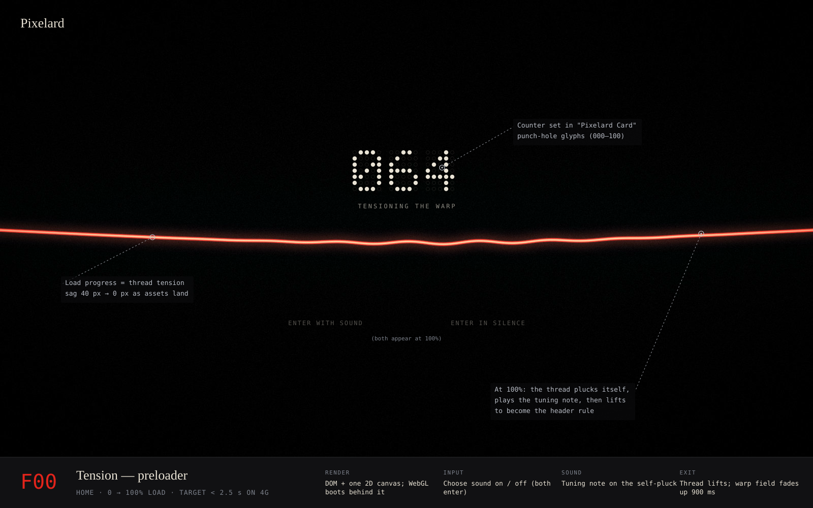

| | |
|---|---|
| **When** | First visit, from 0 to 100% loaded. Repeat visits in the same session skip to a 400 ms version. |
| **World** | Black. A single red thread spans the screen. It sags 40 px at 0% and is taut at 100% (load progress = tension). |
| **DOM** | Wordmark, counter in *Pixelard Card* glyphs (`000`–`100`), label "Tensioning the warp". |
| **At 100%** | Two quiet choices appear: **Enter with sound** / **Enter in silence**. Either one starts the experience. |
| **Exit** | The thread plucks itself (it vibrates and plays the tuning note if sound is on), then **rises to become the loom's back beam**, and the warp unrolls from it (H01). |
| **Why** | The loader *is* the first piece of the story: the warp must be tensioned before weaving begins. |

### HERO — The Loom · the first 10 seconds · 0–100 vh

> **The most important screen on the site.** It is designed against the reference's hero (`01` §A2) and the hero rules H1–H6.
> Lusion's hero is a beautiful toy that proves rendering skill.
> **Ours is a toy that *is* the studio's idea:** the visitor's cursor becomes the shuttle and weaves the Pixelard wordmark as a Jacquard.
> What they weave is kept and comes back at the end.

**Layout** (desktop 1440–1600 wide; values for 1600 × 900):

| Zone | Content |
|---|---|
| Header row (y 30–60) | Wordmark · chapter index `00 / 07 — THE LOOM` · Sound · Menu · ● Start a thread |
| Headline zone (y 100–220) | H1 at ~54 px serif, two lines, left aligned: **"Every image on your screen / *was woven.*"** Right column: a two-line mono hint, *"Move across the threads to weave · Click to change yarn · Hold to beat"*, shown until the first completed row. |
| **Stage** (y 236–806) | The **back beam** (top hairline) and **breast beam** (bottom hairline), each with punched-hole end marks. About 150 warp threads at a ≈9 px pitch span between them. The cloth grows **up** from the breast beam. |
| Instrument bar (y 830–860) | `ROWS 008 / 062` · "Scroll to weave on" · `● YARN SILK` |

**Why a beam-framed stage.** It follows rule H3 (type beside the world, and a frame that doubles as a transition). The frame comes from the loom, not from a rounded card: the beams *part* to become the transition into the world.

#### H01 — Portal: one thread becomes the warp · 0–1.1 s after load
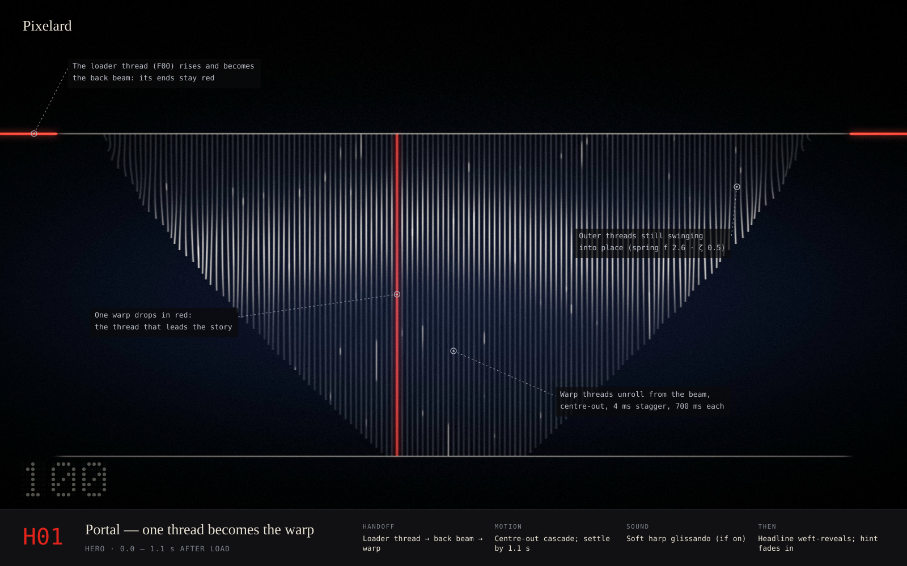

1. The preloader's red thread (F00) rises to the back-beam position. Its ends stay red and its body turns silk.
2. Warp threads **unroll from the beam, centre-out** (4 ms stagger, 700 ms each, `tension` ease). Outer threads swing into place on a spring.
3. One warp drops in red. That is the thread that will lead the story.
4. The headline weft-reveals at 0.8 s; the hint fades in at 1.2 s.
5. Sound (if on): a soft harp glissando that follows the cascade.

#### H02 — The loom at rest · 1.1 s → first input
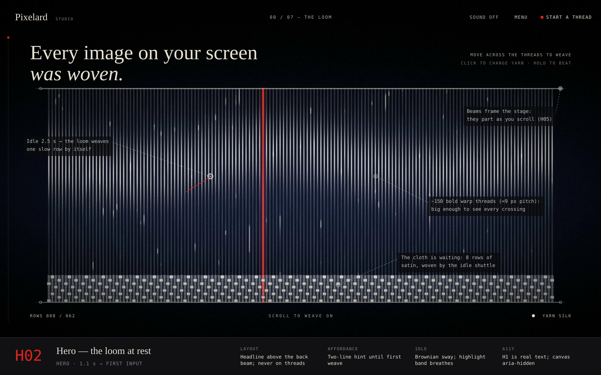

- The cloth already has **8 rows** of plain satin, so the visitor sees what woven cloth looks like before acting.
- Threads sway (Brownian), and the anisotropic highlight band breathes and leans toward the pointer.
- **Idle auto-weave:** after 2.5 s with no input, the loom weaves one slow row by itself (the shuttle crosses on its own). It demonstrates the interaction without words, and it is what mobile and keyboard visitors see first.

#### H03 — Your cursor is the shuttle · first 3–10 s of play
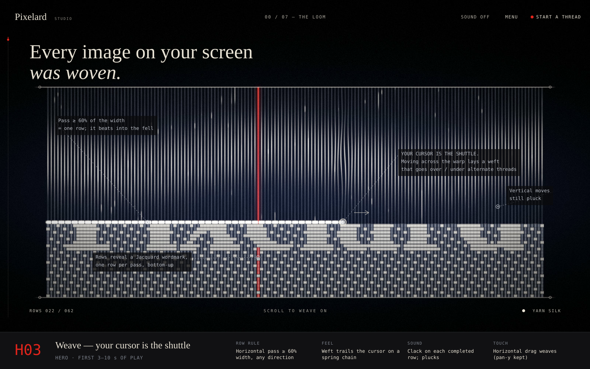

- **Laying the weft.** When the pointer moves horizontally across the warp, a weft thread trails it on a spring chain. It is laid **over and under alternate threads** (the interlacing is visible).
- **Completing a row.** A pass covering ≥ 60% of the warp width, in either direction, completes a row:
  - the weft **beats into the fell**, a short downward snap;
  - a soft wooden clack plays;
  - the `ROWS` counter steps.
- **The image.** Rows reveal a **satin Jacquard of the Pixelard wordmark**, bottom-up: letters are weft-faced (yarn colour) and the ground is warp-faced (graphite).
- **The rest still responds.** Vertical movement plucks. Short horizontal jiggles leave a loose weft that relaxes and fades (no row).

#### H04 — Click to change yarn · repeatable play
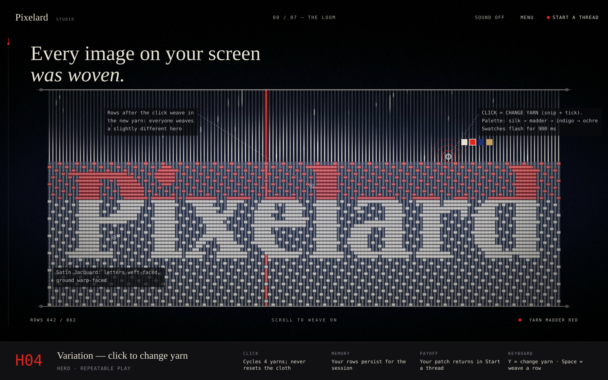

- **Click** inside the stage snips the weft: a "snip" plus a tick, and the four yarn swatches flash for 900 ms.
- The yarn cycles **silk → madder red → indigo → ochre**. New rows weave in the new yarn and earlier rows keep theirs.
- No two visitors weave the same hero. Clicking never resets the cloth.
- **Keyboard:** `Space` weaves a row, `Y` changes yarn. Touch: tap to change yarn, horizontal drag to weave.

#### H05 — Scroll-out: the loom opens into the world · 0–100 vh
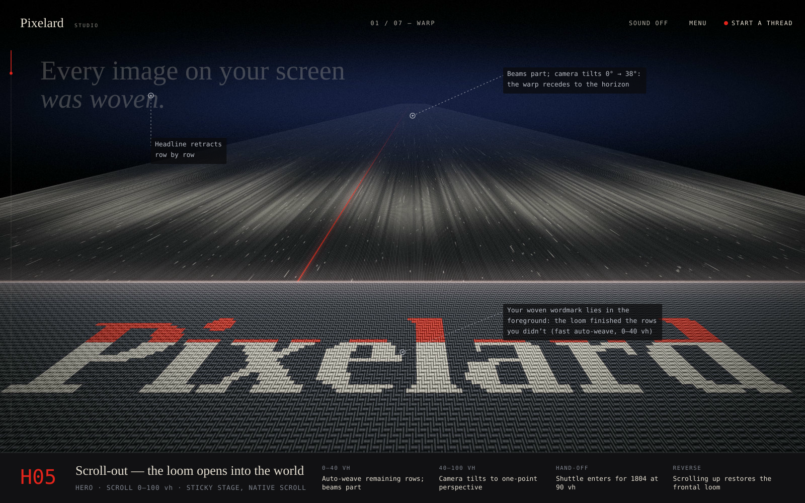

| Scroll | What happens |
|---|---|
| 0–40 vh | If the wordmark is unfinished, the loom **auto-weaves the remaining rows** quickly, so everyone ends with a finished woven wordmark. The beams **part** (back beam up and out, breast beam down and out). The headline retracts row by row. |
| 40–100 vh | The camera tilts from frontal (0°) to the **one-point perspective**: the warp recedes to an indigo horizon and **the visitor's woven wordmark lies in the foreground**. |
| 90 vh | The shuttle enters from the left for chapter 1804. |
| Reverse | Scrolling up restores the frontal loom with the visitor's rows intact. |

**The payoff (H6).** The rows (and yarn colours) the visitor wove are stored for the session (`sessionStorage`). In F09 (*Start a thread*), **the cloth at the bottom of the screen is their patch**, and the red thread pulls free from it. On `/contact` it shows under the caption *"You started this thread at 00:12."*

**3-second test (H1).**
- **Craft:** glossy threads and real crossings at hero scale.
- **Action:** the first horizontal movement lays a weft and the first vertical movement plucks.
- **Statement:** the H1 sentence, set apart from the stage.

### F02 — 1804 (origin) · 100–250 vh
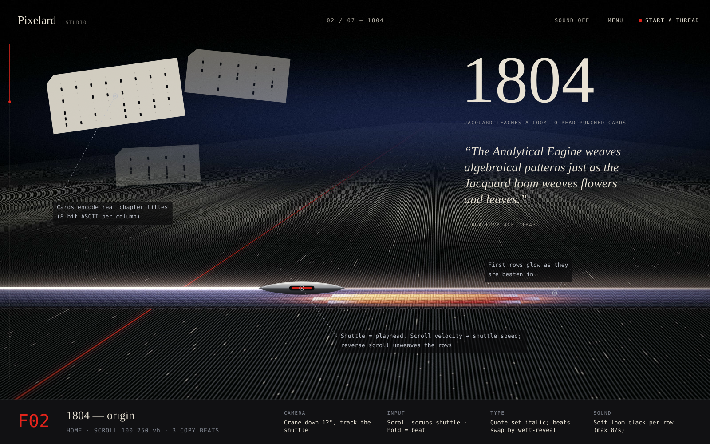

| | |
|---|---|
| **World** | The shuttle crosses the warp and lays the first weft rows, which glow at the fell. Punch cards drift through the haze; their holes encode the chapter titles in ASCII. |
| **Camera** | Cranes down 12° and tracks the shuttle. |
| **Copy beats** | ① **"1804. Jacquard teaches a loom to read punched cards."** ② Lovelace: *"The Analytical Engine weaves algebraical patterns just as the Jacquard loom weaves flowers and leaves."* (1843) ③ **"Every pixel since is a crossing of threads. We still weave."** |
| **Interaction** | Scroll **scrubs** the shuttle: scroll velocity becomes shuttle speed, and reverse scroll unweaves the rows. Press and hold is available (Beat, see F04). |
| **Sound** | A soft wooden loom clack per completed row, limited to 8 per second. |

### F03 — Weave, macro · 250–300 vh
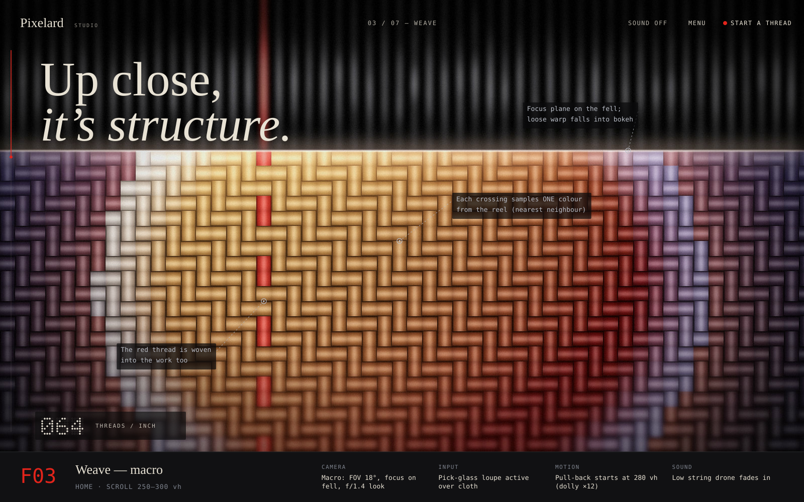

| | |
|---|---|
| **World** | Macro view of the fell. Big, glossy twill crossings, each one a single colour sampled from the showreel. The red thread is woven *into* the image. The loose warp above falls into bokeh. |
| **Camera** | FOV 18°, focus plane on the fell, shallow depth of field. |
| **DOM** | **"Up close, it's structure."** HUD: thread count `064` threads per inch. |
| **Interaction** | Pick-glass loupe over the cloth (S03). |
| **Scroll out** | At 280 vh the camera begins a ×12 dolly pull-back, and the next headline is staged. |

### F04 — Weave, wide + Beat · 300–400 vh
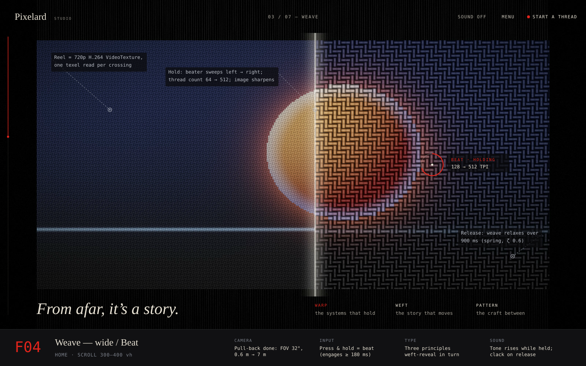

| | |
|---|---|
| **World** | The pull-back completes. The cloth now fills the frame and the **showreel reads clearly as a moving woven image**: the signature moment. |
| **DOM** | **"From afar, it's a story."** Three principles reveal in sequence: **Warp**, the systems that hold. **Weft**, the story that moves. **Pattern**, the craft between. |
| **Interaction** | **Press and hold = Beat.** The beater bar sweeps the cloth. Thread count climbs from 64 to 512 TPI, the image sharpens, and a tone rises. On release the weave relaxes with a slight overshoot. The frame shows the sweep half-way. |
| **Why** | The idea that *higher thread count = higher resolution* is the pixel metaphor, made physical and playable. |

### F05 — Pattern Book (selected work) · 400–700 vh · pinned
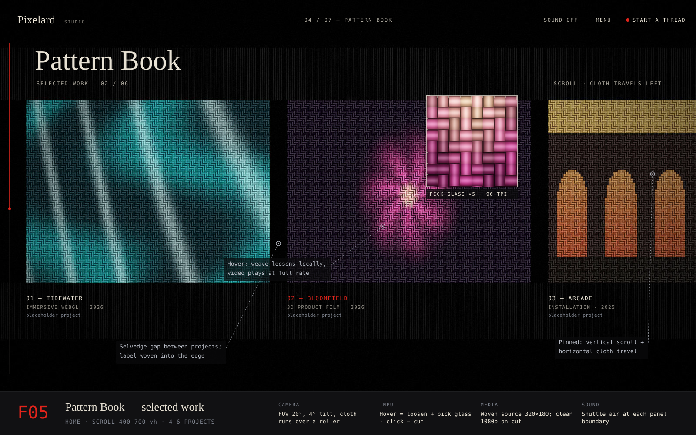

| | |
|---|---|
| **World** | The cloth runs over a roller and becomes a horizontal bolt. Vertical scroll drives horizontal travel. Each project is woven as a panel. **Selvedge** gaps separate the projects, with labels woven into the edge (number, name, discipline, year). |
| **Interaction** | Hovering a panel loosens the weave locally and the video plays at full rate. The **pick glass** shows the magnified weave with a thread-count ruler. Click = **The Cut** (F06). |
| **Content** | 4–6 featured projects. Woven sources are tiny (320×180); clean media loads on hover intent. |
| **Sound** | Shuttle air at each panel boundary. |

### F06 — The Cut: work → case study
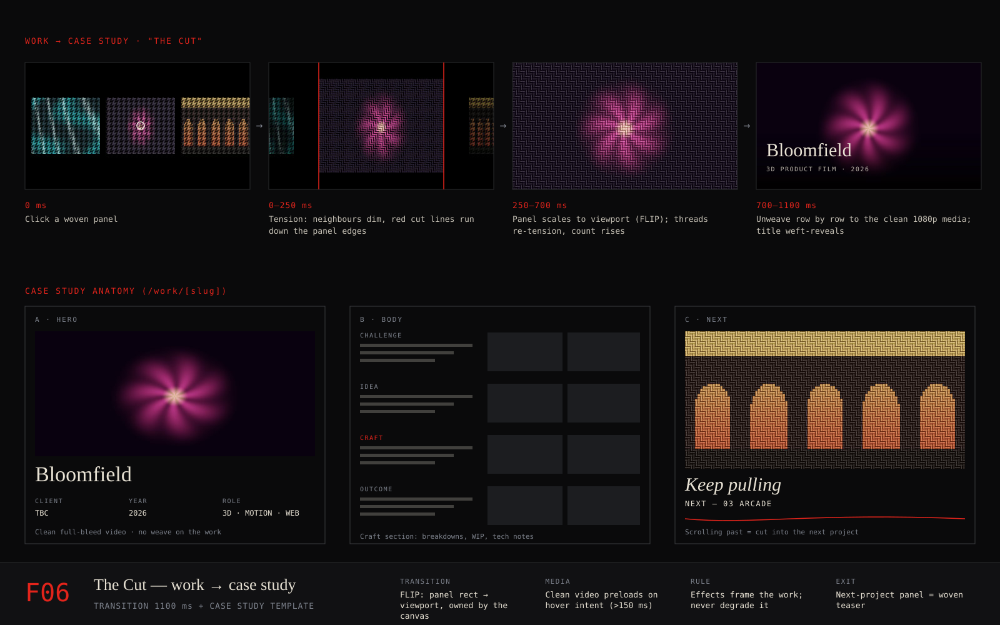

| | |
|---|---|
| **Sequence (1100 ms)** | **0 ms** click. **0–250 ms** tension: neighbours dim and red cut lines run down the panel edges. **250–700 ms** the panel scales to the viewport (FLIP) and its threads re-tension. **700–1100 ms** it unweaves row by row into the **clean** 1080p media and the title weft-reveals. |
| **Case study** | **A · Hero:** clean full-bleed video, title, meta (client, year, role). **B · Body:** Challenge / Idea / Craft / Outcome, with the Craft section carrying breakdowns, WIP and tech notes. **C · Next:** the next project as a woven teaser; "Keep pulling" cuts into it. |
| **Rule** | **Effects frame the work; they never degrade it.** No weave, distortion or grain over client media inside a case study. |

### F07 — Draft (capabilities) · 700–850 vh · light-mode rest beat
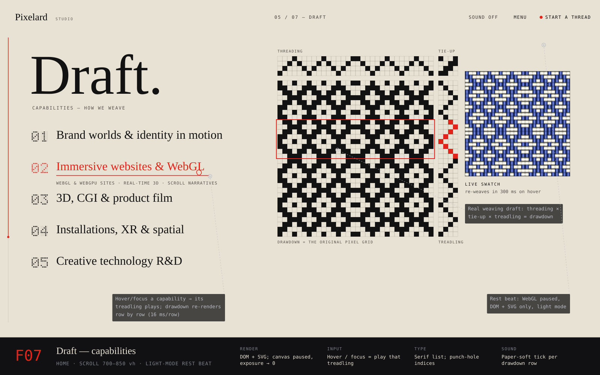

| | |
|---|---|
| **World** | The screen turns to Raw Silk. The canvas exposure fades to 0 and **WebGL pauses**. A real **weaving draft** fills the right side: threading × tie-up × treadling = drawdown, the original pixel grid. A live woven swatch sits beside it. |
| **DOM** | **"Draft."** with five capabilities, each indexed with punch-hole numerals: Brand worlds & identity in motion · Immersive websites & WebGL · 3D, CGI & product film · Installations, XR & spatial · Creative technology R&D. *(Placeholder list; confirm with the studio.)* |
| **Interaction** | Hovering or focusing a capability plays its treadling. The drawdown re-renders row by row and the swatch re-weaves. |
| **Why** | A calm, high-contrast, information-dense beat. It rests the eye and the GPU and shows the studio's thinking. |

### F08 — Selvedge (clients and people) · 850–950 vh
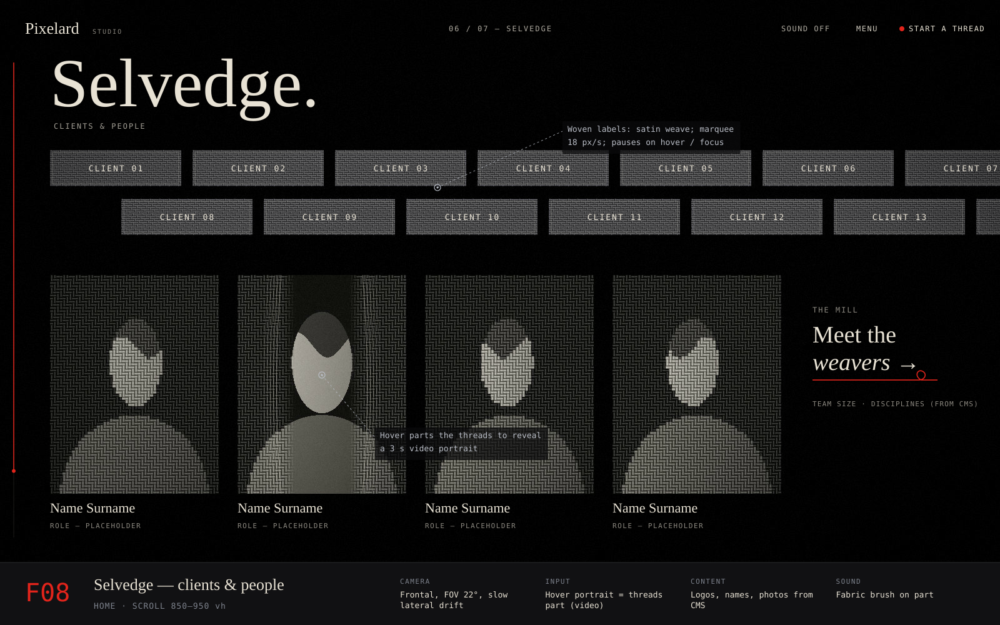

| | |
|---|---|
| **World** | Back to dark. Clients appear as **woven satin labels** in two offset marquee rows. Team members appear as **Jacquard-woven portraits**, a nod to the famous woven portrait of Jacquard. |
| **Interaction** | Hovering a portrait parts the threads to reveal a 3 s video portrait. The marquee pauses on hover or focus. |
| **Link** | "Meet the weavers →" goes to `/studio`. |

### F09 — Start a thread (contact) · 950–1050 vh
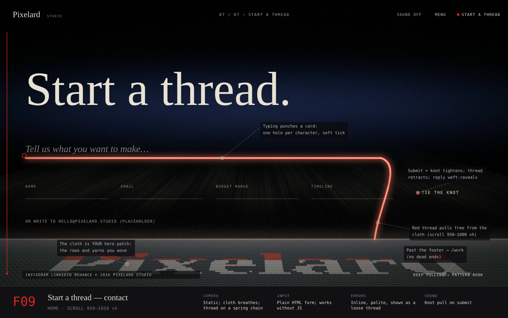

| | |
|---|---|
| **World** | The red thread that has run through the site **pulls free from the cloth**, rises, and becomes the underline of the message field. **The cloth is the visitor's own hero patch** (their rows, their yarn colours). |
| **DOM** | **"Start a thread."** Field: *"Tell us what you want to make…"*, then Name · Email · Budget range · Timeline, then submit **"Tie the knot"**. Direct email as an alternative. |
| **Interaction** | Typing punches a card: one hole per character, with a soft tick. Submitting tightens the knot, the thread retracts, and the confirmation weft-reveals: *"Knot tied. We'll reply within two working days."* (SLA is a placeholder). |
| **Footer** | Fringe links (socials, legal). **Scrolling past the footer cuts into `/work`.** No dead ends. |

---

## 6. Global systems

### S01 — Punch-card menu
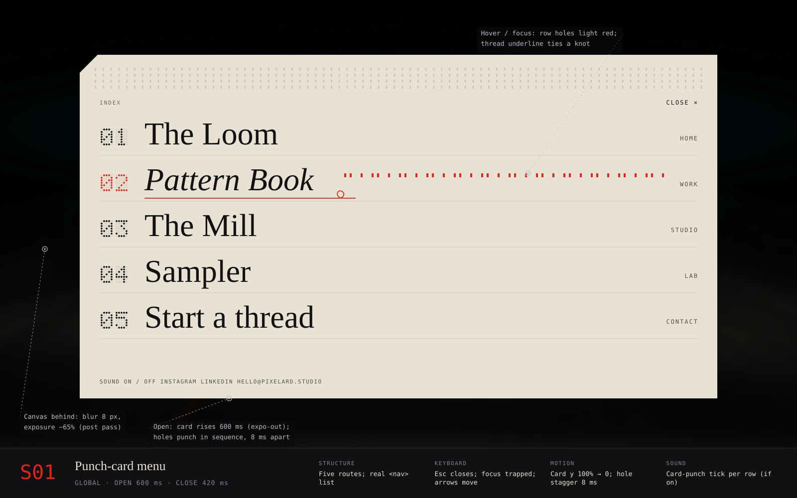

A Raw Silk card with a cut corner, like a real punch card, rises over the blurred world. Five routes, each indexed with punch-hole numerals. Hover or focus lights that row's holes red and ties a thread underline. It is a real `<nav>` with a focus trap, `Esc` to close and arrow-key navigation.

### S02 — Shuttle-pass page transition
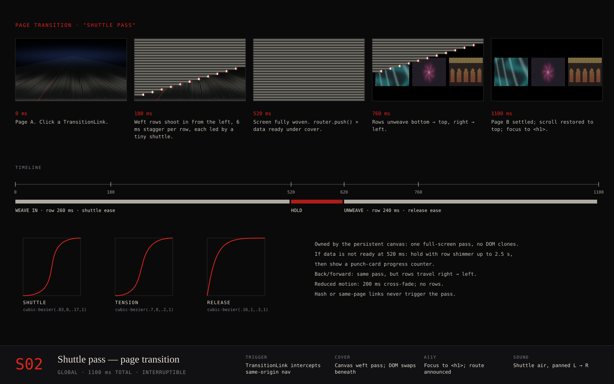

1. Weft rows shoot in, each led by a tiny shuttle, and weave the screen shut (520 ms).
2. The route changes under cover.
3. The rows unweave to reveal the new page (480 ms).

It is owned by the persistent canvas, interruptible, and direction-aware (back = right to left). Reduced motion gets a 200 ms cross-fade.

### S03 — Cursor and input: "the Needle"
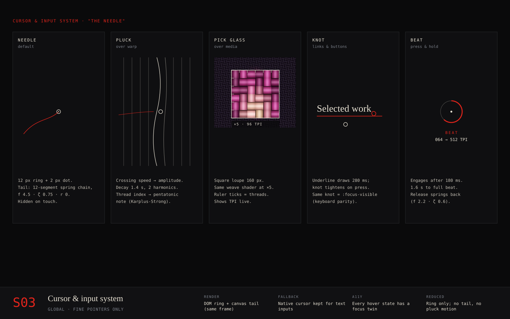

There are six states:
- **Shuttle** (in the hero stage, see H03; the ring becomes a small shuttle that turns toward its direction of travel)
- **Needle** (default)
- **Pluck** (over warp)
- **Pick glass** (over media)
- **Knot** (links and buttons)
- **Beat** (press and hold)

Every hover state has a keyboard-focus twin.

### S04 — Mobile: the portrait loom
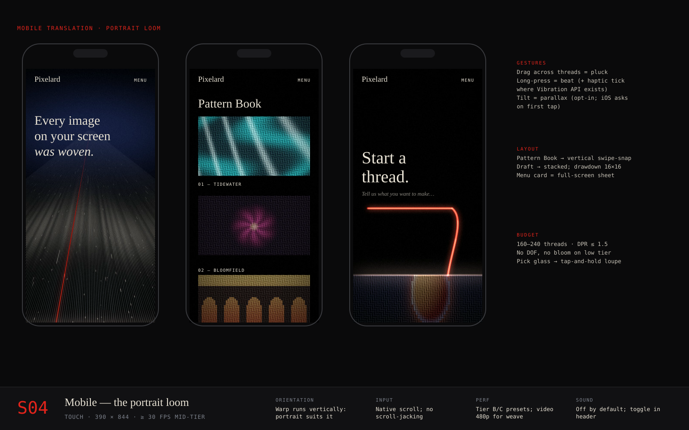

Portrait screens suit a loom: the warp runs vertically.
- **Gestures:** drag across threads to pluck; long-press to beat.
- **Layout:** the Pattern Book becomes a vertical swipe-snap stack.
- **Scroll:** native, never hijacked.

## 7. Secondary routes (beats)

**`/work`: Pattern Book (archive)**
1. **Intro:** "Pattern Book", a count of projects, and filter chips.
2. **Swatch rail:** every project hangs as a woven swatch on a horizontal rail, gently swinging, with cloth physics on hover only.
3. **Filters:** optional disciplines (Web, Film/3D, Spatial) are each signified by a weave structure on the swatch (plain, twill, satin). This is an easter egg for the attentive, never the only signal; text labels always show.
4. **Click:** The Cut (F06).
5. **List view toggle:** a plain, accessible table view of all projects, the fastest route for return visitors.

**`/work/[slug]`: The Bolt.** Template in F06 (A Hero, B Body with Challenge/Idea/Craft/Outcome, C Next). Optional per-project "loom card": a small spec plate listing the team, tools and thread count of the hero woven still.

**`/studio`: The Mill**
1. **Hero:** "The Mill". The team's woven portraits run along a long loom, and the camera tracks sideways as you scroll.
2. **From thread to cloth (process):** one swatch is scroll-scrubbed through four states:
   - **Discover:** raw fibre spun into thread
   - **Draft:** the pattern on a grid
   - **Weave:** cloth forms
   - **Finish:** pressed, cut and labelled
   Each state carries 2–3 sentences of the actual process.
3. **Capabilities in depth:** the expanded Draft.
4. **Clients:** woven labels. **Recognition:** awards and press as woven hallmark tags. **Talks.**
5. **Careers:** "Join the mill."
6. CTA → Start a thread.

**`/lab`: Sampler**
- A grid of small square test swatches, one per experiment, each with a date and a one-line note.
- Opening one plays it live, sandboxed (lazy, in an iframe), or as video.
- This is where the **Pinscreen** and **Additive** ideas from `02-creative-directions.md` can live as experiments.

**`/404`: Dropped stitch**
- A torn row, with one loose thread swinging.
- Copy: *"Dropped stitch. This thread doesn't lead anywhere — yet."*
- The CTA "Pick it up →" re-ties the thread and transitions home.

## 8. Accessible and fallback edits

These are first-class versions of the site, not error states.

| Condition | Edit |
|---|---|
| `prefers-reduced-motion: reduce` | No camera flights, plucks or autoplay. Each chapter shows a **still woven frame** with a 200 ms cross-fade between chapters. Beat becomes a toggle button: "Show high thread count". The red-thread rail stays (static). |
| No WebGL / WebGL context lost / low-power tier C | The DOM-only site with pre-rendered **woven stills** (generated at build) in place of the canvas. Every piece of content and every route still works. |
| Keyboard only | Every hover has a focus twin. A skip link goes to main content. The menu is fully operable. Pattern Book items are reachable in DOM order. |
| Screen reader | The canvas is `aria-hidden`. All copy is real text. Each case-study media item carries alt text and a transcript or description. |
| 200% zoom / narrow widths | Fluid type with `clamp()`. Never `user-scalable=no`. Layouts reflow; no horizontal scroll outside the Pattern Book track. |

## 9. Copy deck v0

*Draft copy. The studio owns final voice. Treat as placeholders until approved.*

| Slot | Copy |
|---|---|
| Loader label | Tensioning the warp |
| Sound choice | Enter with sound · Enter in silence |
| Hero H1 | Every image on your screen was woven. |
| Hero sub | Pixelard is a digital craft studio: design, 3D, motion & creative technology. |
| Origin beats | 1804. Jacquard teaches a loom to read punched cards. / *Lovelace quote* / Every pixel since is a crossing of threads. We still weave. |
| Weave | Up close, it's structure. / From afar, it's a story. |
| Principles | Warp: the systems that hold. Weft: the story that moves. Pattern: the craft between. |
| Beat hint (first time only) | Hold to raise the thread count |
| Work | Pattern Book. Selected work. |
| Capabilities | Draft. How we weave. |
| Clients and people | Selvedge. The edge that holds everything together. |
| CTA | Start a thread. |
| Field placeholder | Tell us what you want to make… |
| Submit | Tie the knot |
| Success | Knot tied. We'll reply within two working days. |
| Footer onward | Keep pulling → Pattern Book |
| 404 | Dropped stitch. This thread doesn't lead anywhere — yet. / Pick it up → |

## 10. Content the studio must supply

| Item | Spec |
|---|---|
| Showreel | 30–60 s master, ProRes or high-bitrate H.264. Cuts that read at low resolution (bold shapes, high contrast). |
| Featured projects (4–6) | Per project: title, client, year, disciplines, a 1-sentence hook; a hero loop (8–12 s, no text burn-ins); 6–12 media items; Challenge/Idea/Craft/Outcome copy; credits. |
| Archive projects | Title, client, year, disciplines, thumbnail loop or still. |
| Team | Name, role, photo (neutral background, consistent lighting), optional 3 s video portrait. |
| Clients | Names and permission to show; SVG logos for the `/studio` page. |
| Recognition | Awards, press, talks (name, year, link). |
| Capabilities | Final list and one-line descriptions. |
| Contact | Destination inbox or CRM, SLA, budget and timeline brackets. |
| Legal | Privacy, cookies (audio and analytics), imprint if needed. |
