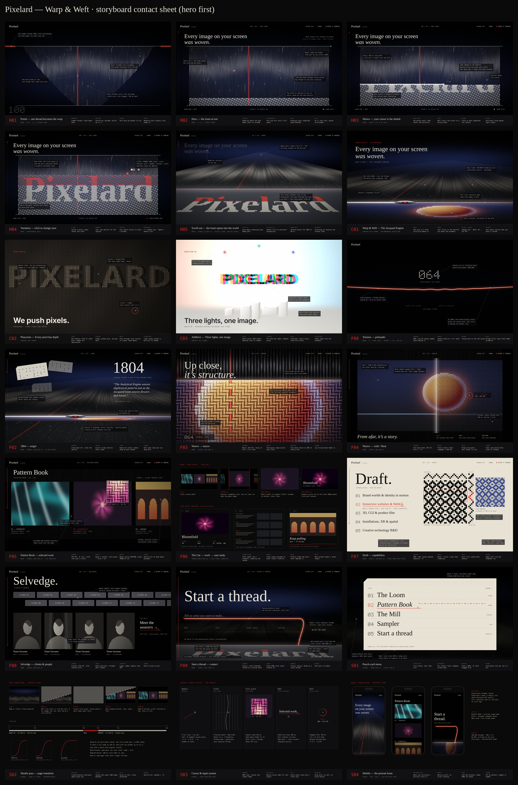

# Pixelard: creative direction pack

These are the pre-production deliverables for the Pixelard Studio website. No production code is written yet.

| # | Document | What it answers |
|---|---|---|
| 01 | [Reference analysis](01-reference-analysis.md) | Why lusion.co works, **homepage hero first** (the 3-second test, toy in a frame, logo-as-portal). Principles to keep, identity to leave. |
| 02 | [Three creative directions](02-creative-directions.md) | **Warp & Weft** (recommended), **Pinscreen**, **Additive**: concept, hero, type, 3D, interaction, scroll, risks, scoring |
| 03 | [Experience and storyboards](03-experience-storyboards.md) | The full site as one world: **hero deep-dive (H01–H05)**, home chapters (F00–F09), systems (S01–S04), routes, copy deck, content needs |
| 04 | [Motion and interaction spec](04-motion-interaction-spec.md) | Tokens, springs, scroll map, camera rail, **hero weaving systems**, cursor, Beat, transitions, sound, reduced motion, QA |
| 05 | [Technical brief for Codex](05-technical-brief-codex.md) | Stack, architecture, shaders, tiers, budgets, milestones (**M1 = hero**), risks, definition of done |

## The idea in one line
**Pixelard ≈ Pixel + Jacquard.** The site is a loom. In the hero, **your cursor is the shuttle**: you weave the Pixelard wordmark yourself, and the patch you wove comes back at the end, when the red thread pulls free from it to "Start a thread".

## Storyboards (`storyboards/`)

| Set | Frames |
|---|---|
| Concepts | `c01` Warp & Weft · `c02` Pinscreen · `c03` Additive |
| **Hero (first 10 s)** | `h01` portal · `h02` loom at rest · `h03` cursor is the shuttle · `h04` change yarn · `h05` scroll-out |
| Home chapters | `f00` preloader · `f02` 1804 · `f03` macro · `f04` wide + Beat · `f05` Pattern Book · `f06` the Cut · `f07` Draft · `f08` Selvedge · `f09` Start a thread |
| Systems | `s01` menu · `s02` transition · `s03` cursor · `s04` mobile |

Frames are rendered illustrations of intent (procedural renders plus annotated SVG), not pixel-final comps. Names of projects, clients and people are placeholders.
