# 02 — Direction A: Every Piece Is Whole

> **Status:** chosen by the studio from the six candidates in `01-candidates.md`. This document develops it with rendered homepage keyframes.
> **Not final:**
> - the logo / wordmark drawing
> - the typeface
> - the palette
> - the material system
>
> Section 9 lists the options and the decisions needed. **No production code is written until you approve.**

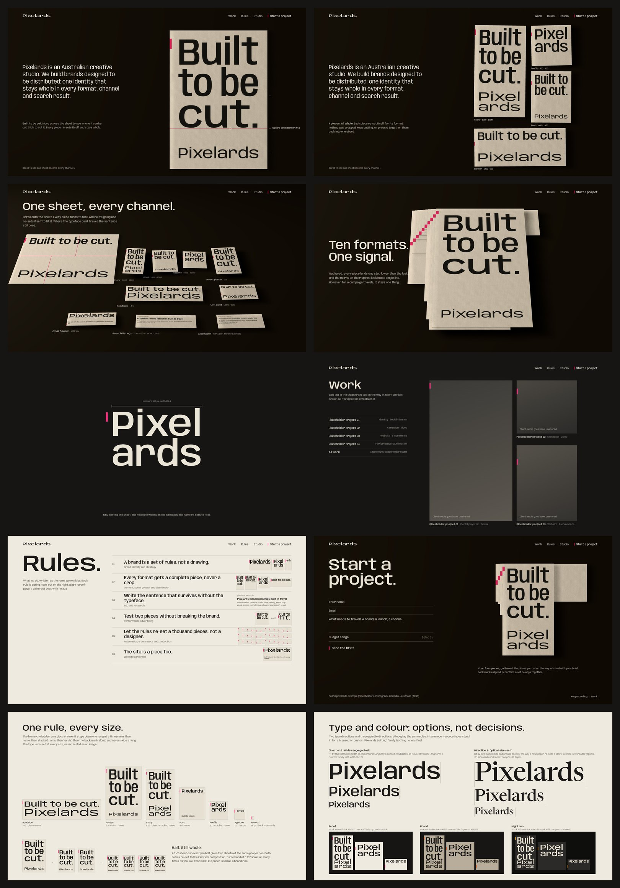

---

## 1. The idea

A Pixelards brand is not a drawing; it is **a set of setting rules**.

**The rules:**
- Set it once, then cut it into everything it needs to become: story, post, billboard, email, search result, AI answer.
- **Every piece re-sets itself to stay whole. Nothing is ever cropped.**
- When the pieces are gathered back together, a small mark on each one's spine locks into a single line, proving they belong to one signal.

**How the brief maps onto it:**

| The brief | Direction A |
|---|---|
| **Living Identity** (a flexible system, not a static logo) | The rules: the fit rule, the hierarchy ladder, the back mark. The wordmark is never one fixed drawing; it is "Pixelards, set to fill". |
| **Distribution Machine** (one identity, every channel) | The cut. One sheet becomes every format and channel, and each piece is complete. |
| Transforms, multiplies, adapts, travels, reconnects | Re-sets · cuts into many · fits any measure · leaves for its channel · gathers into one diagonal |
| AI-first, without clichés | The rules are an engine: they re-set a thousand pieces without a designer redrawing each one (Rule 05). AI is shown as a *way of working*, never as imagery. |
| Branding-first + SEO/AI search | Where the typeface can't travel (a search listing, an assistant's answer), **the sentence still does.** The brand includes copy written to fit 60 and 155 characters. |

**Why it suits Pixelards in particular.** The name is plural: one studio, many outputs. The permitted break in the wordmark, **"Pixel / ards"**, gives the plural ending its own line every time the name stacks.

## 2. The genome

**What never changes (recognition)**
1. **One voice.** A single variable type family, set in sentence case.
2. **The fit rule.** The primary line of every piece fills its measure exactly. Width and optical size do the fitting; **type is never scaled as an image.**
3. **One permitted break.** The name only ever stacks as **Pixel / ards**.
4. **No crops.** Pieces are re-set, never cropped. Margins are always 1/12 of the piece's short side.
5. **The back mark.** A short bar in the proof colour at the spine edge of every piece. Its position steps down with the piece's place in a set, so gathered sets form one diagonal.
6. **The hierarchy ladder.** claim → name → stacked name → "-ards" → back mark alone. A shrinking piece steps down one rung at a time and never skips one.
7. **Two inks on any stock.** One dark ink, plus one proof colour reserved for the back mark and the active cut.
8. **House proportion 1:√2** (ISO 216) for every owned surface. Cut a sheet in half and both halves are whole sheets: *"Half. Still whole."*

**What adapts (life)**
- **Format:** format and aspect ratio, from a 16 px favicon to a roadside billboard.
- **Type axes:** width, weight and optical size, solved per piece by the fit engine.
- **Copy:** copy, language and phrase breaks (approved claim variants per measure).
- **Surface:** stock (paper colour or screen theme) per channel or client.
- **Rendered pieces:** light angle and colour temperature, following the studio's local time (AEST).
- **Sequence:** position within a set, which steps the back mark down.
- **Cut plan:** how a campaign is divided, set by the brief, or by the visitor on the site.

## 3. Fixing the weaknesses we found

| Weakness (from the candidate's self-critique) | Fix in this development |
|---|---|
| It descends from the Whitney "Responsive W" and fit-to-width type | **Three differences.** Our identity (a) **extends past type** into search and AI answers (§5, frame 04); (b) **reconnects visibly** with the back-mark diagonal (frame 05); (c) runs on **ISO 216's half-cut logic** (study S1). The Whitney W is a responsive *mark*; ours is a responsive *system for distribution*. |
| It could read as a "layout studio", not a growth partner | The **Rules** section (frame 07) turns every capability into a rule that acts itself out: social, SEO/AI search, performance A/B, automation, websites, video. The **Imposition** shows the search listing and AI answer as first-class pieces. |
| Weak on distribution *over time* | The back mark encodes **sequence**: a campaign's pieces, in order, form the diagonal. Production adds dates to the piece captions (format · channel · week). |
| Cutting might read as shredding the brand | The **ghost preview** shows both pieces re-set *before* you cut. **Gather (G)** always restores the sheet. The state line says "4 pieces. All whole." |
| Fitted type gets ugly at extreme ratios | **Detents** snap cuts to real channel ratios and **refuse** slivers. The ladder steps down rather than producing an ultra-condensed tower (study S1). |
| The interim fonts feel generic | We run on open-source faces (Anybody / Newsreader) only until the type decision (§9). Long term, a custom "Pixelards Setting" family (wdth 50–170) with an "-ards" ligature. |
| Small mobile screens give unusable pieces | Mobile cuts along the short axis only, two or three cuts at most, stacked vertically (frame M1). Native scroll is never captured. |

## 4. Homepage storytelling (keyframes)

These are real renders: three.js for the board, raking light and shadows, plus **live DOM typography** fitted by the actual fit rule, screenshotted headlessly. Placeholders are labelled. Type and colour are interim (§9).

### 01 · Preloader: "Setting the sheet"
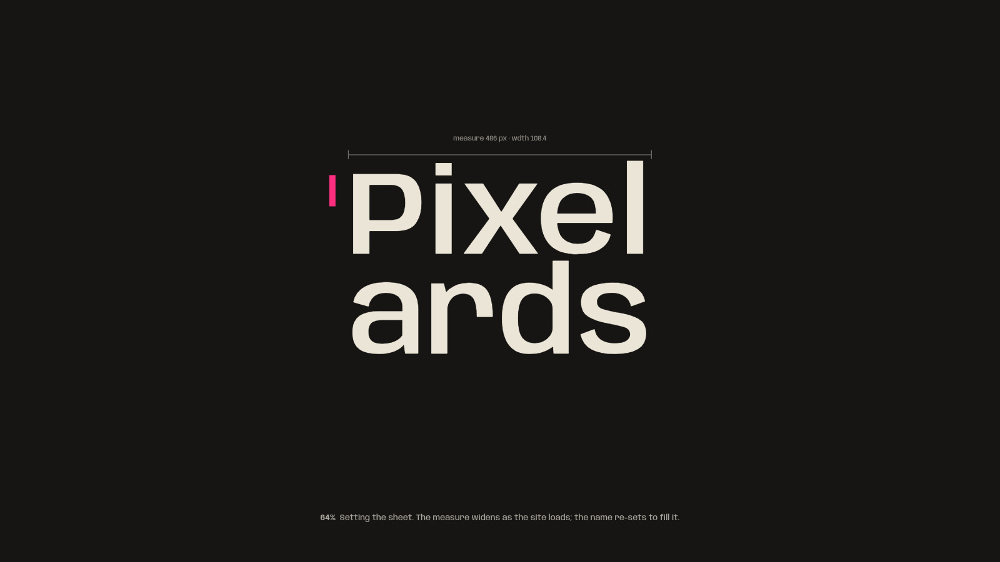
- **What happens:** while the site loads, the measure widens and the name re-sets to fill it, stacked as "Pixel / ards" until the measure allows one line. The counter is the measure itself.
- **Hand-off:** at 100%, the line becomes the top line of the hero sheet.

### 02 · Hero: "Built to be cut."
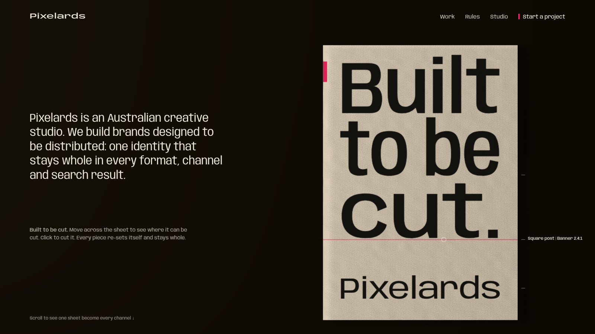
- **Layout:** the plain sentence sits in columns 1–5. A 1:√2 board sheet lies in columns 6–12 under a single low raking light.
- **Cut guide:** moving across the sheet shows a hairline guide that **snaps to real channel ratios**. The label reads "Square post | Banner 2.4:1", with ticks marking the detents.
- **The 3-second test:**
  - **Craft:** the board, the light and real typesetting.
  - **Action:** the first movement shows the cut guide.
  - **Statement:** one plain sentence.

### 03 · Hero, after three cuts: "4 pieces. All whole."
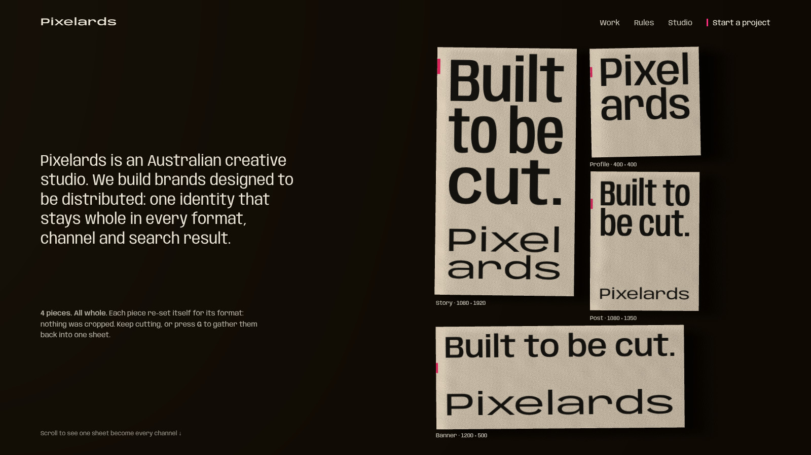
- **The pieces:** story, profile, post and banner, each **re-set** for its format and captioned with real dimensions.
- **The back marks** step down per piece, ready to gather.
- **Repeatable reward:** every cut produces new, complete pieces.
- **Trace:** your cut plan returns as the layout of Work (06) and travels with your brief at Contact (08).

### 04 · One sheet, every channel (the distribution set piece)
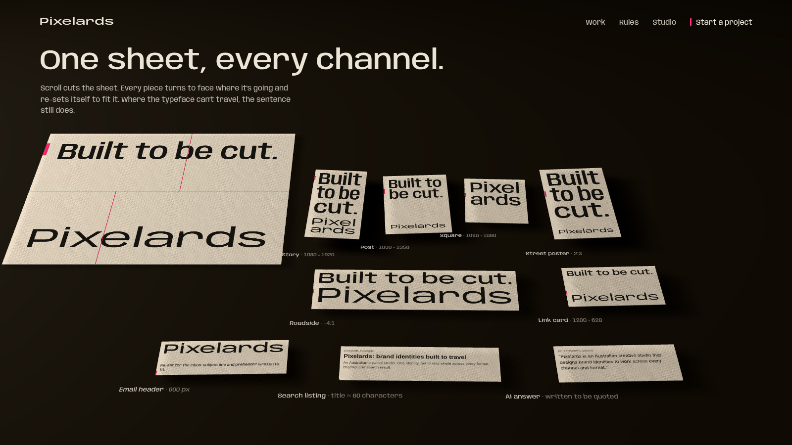
- **Scroll cuts a big press sheet.** Pieces slide out, turn to face their channel and re-set: story, post, square, street poster, roadside, link card, email header.
- **Two pieces carry no brand type at all:** a **search listing** and an **AI answer**. *"Where the typeface can't travel, the sentence still does."*
- **Captions** give format and spec only. There are no reach numbers or dashboards.

### 05 · The gather (signature moment)
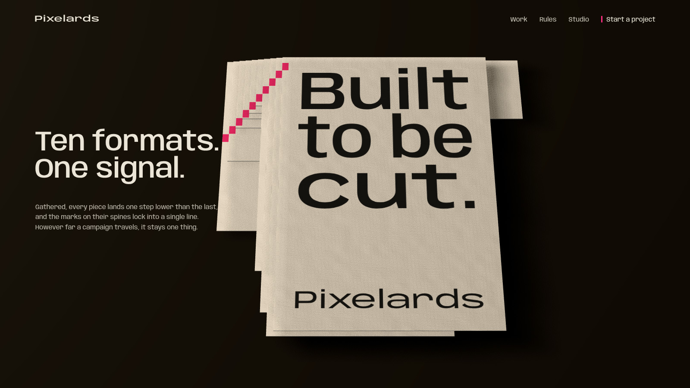
- **The landing:** ten formats fly back and stack. Each lands one bar-width further over, and the back marks lock into **one unbroken diagonal**: *"Ten formats. One signal."*
- **Reverse:** reverse scroll fans them out again.
- **Why it matters:** it is the visible proof of the brief's "reconnects", and it uses the bookbinder's collation mark, honestly repurposed.

### 06 · Work: laid out in your cut
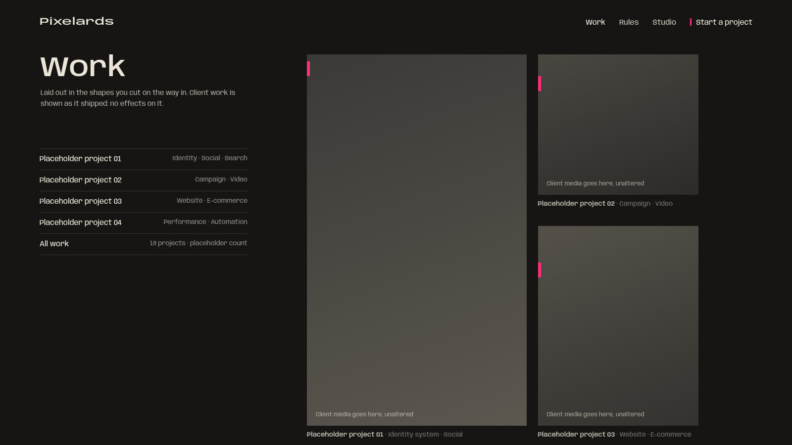
- **Layout:** a calm index whose tiles take the shapes the visitor cut in the hero.
- **Client work** is shown as it shipped: no weave, distortion or effects on client media.
- **Projects** are placeholders until the studio supplies real ones.

### 07 · Rules: what we do, as the rules we work by
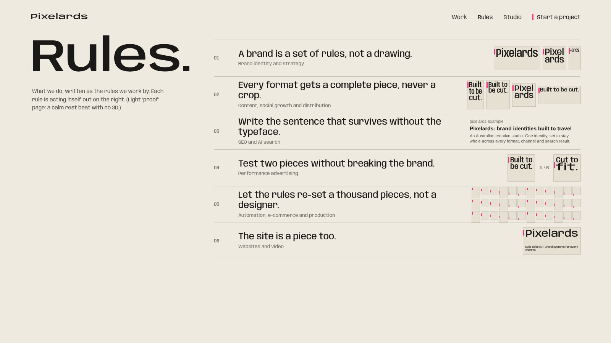
- **The page:** a light "proof" page, a rest beat with no 3D.
- **Six capabilities, each written as a rule and acted out live:**
  - brand identity
  - content and social
  - SEO and AI search
  - performance A/B
  - automation and e-commerce
  - websites and video

### 08 · Start a project
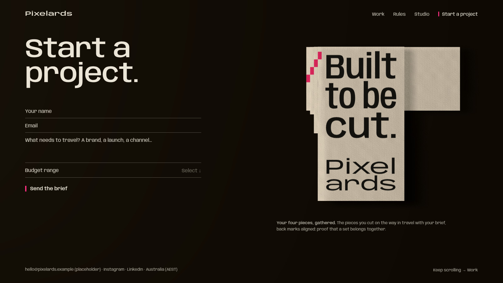
- **The form:** a plain HTML form, which works without JS.
- **Your pieces travel with your brief.** The pieces you cut on the way in are gathered beside the form, back marks aligned.
- **No dead ends:** the footer continues into Work.

### M1 · Mobile hero
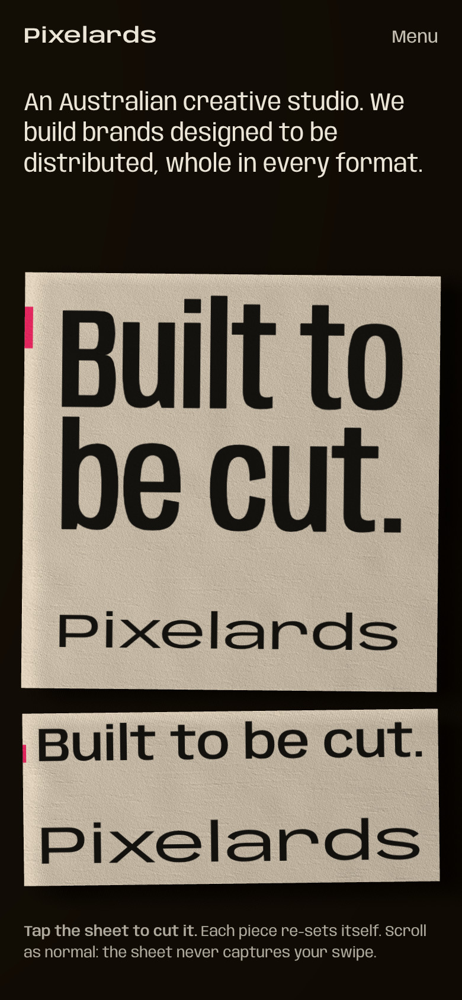
- **Cutting:** tap to cut along the short axis, and the pieces stack.
- **Scroll is never captured.** The sheet only listens to taps.

## 5. Identity explorations (for decision, not final)
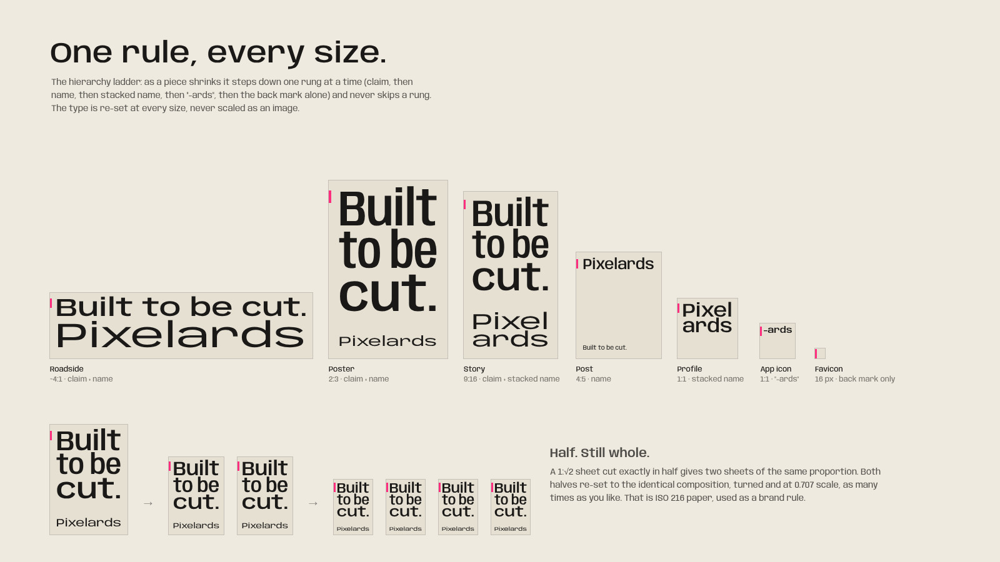
- **The ladder:** the same rules from roadside to favicon.
- **"Half. Still whole."** The ISO 216 half-cut as a brand rule.

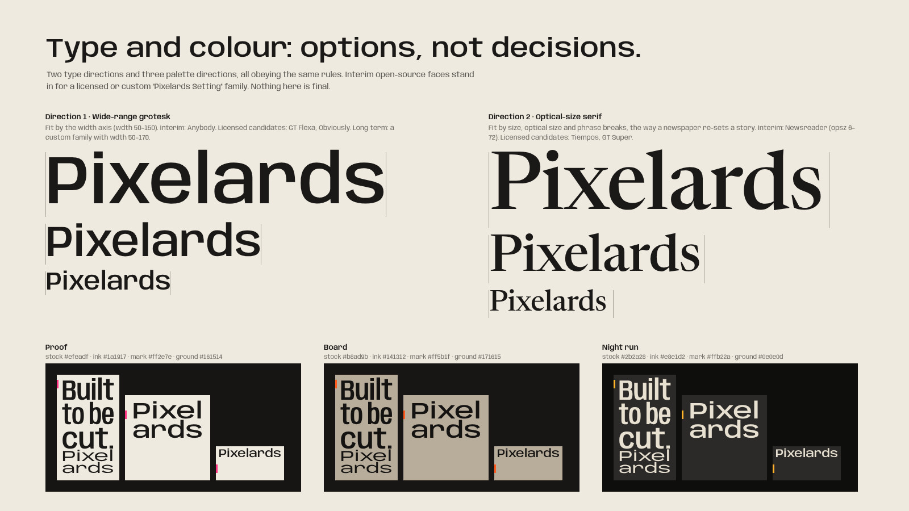
- **Two type directions:**
  - a wide-range grotesk, fitted by width;
  - an optical-size serif, fitted by size and phrase breaks.
- **Three palette directions, each two inks on one stock:**
  - **Proof:** unbleached stock, carbon ink, fluorescent proof pink.
  - **Board:** recycled board, soot, safety orange.
  - **Night run:** graphite stock, bone ink, sodium yellow.

## 6. Motion and transitions
- **Signature move: the re-set.** On reflow, words travel to their new lines in reading order (FLIP) while the axes interpolate, 320–420 ms. **Nothing fades.**
- **The cut:**
  1. The 1-device-pixel line flashes the proof colour for one frame.
  2. It opens into a gap equal to the margin unit (180 ms).
  3. The pieces lift 1–2% and cast longer shadows.
- **The gather:** about 900 ms total; pieces fly in and land one step lower each time, with one dry paper sound (if sound is on).
- **Page transitions:** the current page is "cut" along a hairline, and the next page slides in as the next piece (≤ 600 ms). Reduced motion gets a 120 ms opacity change.
- **Pacing (from the reference study):**
  - spectacle is spent in two set pieces (hero, and Imposition + Gather);
  - everything else is calm, legible and DOM-first.

## 7. Interaction
- **Hover:** the cut guide and ghost preview; the guide snaps within 3% to real channel ratios and refuses cuts below the minimum piece size.
- **Click:** cut. **Double-click or G:** gather.
- **Keyboard:** the stage is focusable. Arrows move between detents, Enter cuts, Backspace undoes and G gathers. A live region announces, for example, *"Cut. Two pieces: square post and banner."*
- **Touch:** tap cuts along the short axis; press-and-hold previews. **No swipe gestures**, so scrolling is never captured.
- **Cursor:** the system cursor. No custom-cursor gimmick; the guide is the feedback.
- **Sound (opt-in):** a dry board cut, and a soft stack on gather.

## 8. Under the hood
- **Generative system: the "fit engine".**
  - **Inputs:** a piece's measure (size, ratio and viewing distance), the copy variants and the stock.
  - **Process:** it climbs down the hierarchy ladder, solves the width and optical-size axes per line, places the back mark by sequence, and emits the piece (DOM, SVG, PNG or video frame).
  - **Use:** the same engine renders the site and **a client's whole campaign**. That is the studio's AI-first production promise made literal.
- **3D, deliberately minimal.**
  - **What's in it:** board sheets with real thickness, a fibre normal map, one low raking light, soft shadows and a "cut glint" on the edges.
  - **What it's for:** the 3D exists to make the format feel physical.
  - **What stays out:** no glossy objects, particles or glass.
- **Built DOM-first.**
  - **Type is real HTML text** (SEO, accessibility, selection). WebGL only renders paper, light and shadow beneath it.
  - **The keyframes were built exactly this way** (three.js plus CSS3D typesetting), which de-risks production.
- **Performance.**
  - **Load:** a few boxes and one shadow-casting light, so the WebGL cost is low. Fonts are the main payload: subset them, with one variable file per family.
  - **Fit engine:** runs on resize and cut only, not every frame.
  - **Targets:** 60 fps desktop and 30+ fps mid-range mobile are realistic.
  - **Fallback:** without WebGL the site is the same DOM with flat paper backgrounds, fully functional.
- **Accessibility:** WCAG 2.2 AA, every interaction keyboard-operable, reduced-motion variants, never blocking zoom.

## 9. Decisions needed from you
1. **Approve Direction A** as the identity direction (or request changes).
2. **Type direction:** wide-range grotesk *or* optical-size serif (study S2). Then licensed candidates (GT Flexa or Obviously; Tiempos or GT Super), or commission the custom "Pixelards Setting" family.
3. **Palette direction:** Proof / Board / Night run (study S2), or a variation.
4. **The claim line:** keep *"Built to be cut."* or explore alternatives. It is a working line, not final copy.
5. **Content:** real projects, team and studio city (the comps say "Australia (AEST)" only), and contact details. The comps use labelled placeholders.

After approval, I'll:
- finalise the identity (wordmark rules, type, palette, back mark spec);
- write the production spec;
- build the site in Claude Code, testing in a real browser as I go.

---

### How these keyframes were made
- **Pages:** each keyframe is a real HTML page (`keyframes/src/a/`): three.js r186 for the board and light, plus CSS3D typography fitted by the live fit rule (`lib.js`), screenshotted in headless Chromium.
- **Fonts:** Anybody and Newsreader (Google Fonts, open source) are interim stand-ins, fetched with `src/tools/fetch_fonts.py`.
- **Status:** this is exploration code, not production code.
